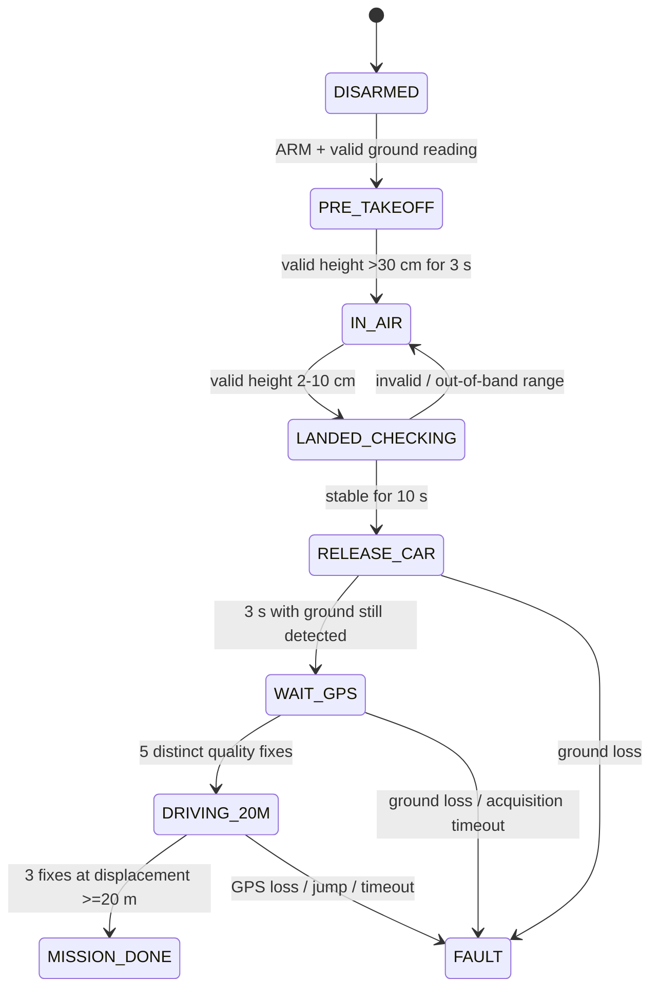

# Air-Drop UGV

**ESP32 mission controller for a drone-carried ground vehicle: detect takeoff, confirm landing, command a release latch, then drive toward a nominal 20 m displacement.**

This repository reconstructs an earlier breadboard prototype from its surviving Arabic engineering document. It contains new English documentation and a new implementation; it is not a recovered copy of the original firmware. The original PDF ends with declarations and contains no `setup()`, `loop()`, sensor-reading functions, or implemented mission transitions.

Read the [English Technical Guide (PDF)](docs/English-Technical-Guide.pdf) for a printable engineering reference.

The controller operates the ground vehicle only. Drone flight, aerial positioning, and release location selection are outside its scope. Despite the project name, the documented sequence commands release after landing, not during free fall.

## What it does

- Starts disarmed with motor outputs off and the latch commanded closed.
- Accepts `ARM` only with a fresh 2-10 cm ground reading.
- Requires valid range readings above 30 cm for 3 seconds to confirm takeoff.
- Requires a continuous 2-10 cm landing indication for 10 seconds.
- Commands the release servo from 90 to 180 degrees and waits 3 seconds.
- Averages five quality-checked GPS updates before starting the motors.
- Stops after three distinct GPS fixes report at least 20 m displacement from the origin.
- Latches a fault on GPS loss, an implausible position jump, drive timeout, or `STOP`.

**Validation status:** 17 host mission scenarios and geodesy checks passed locally and on GitHub; ESP32 firmware compilation passed in [GitHub Actions](https://github.com/rashwan26/airdrop-ugv/actions/runs/44790336348). Hardware operation, mechanical release, stopping distance, and outdoor GPS performance require measurement. See [validation](docs/validation.md) for the actual checks and acceptance procedure.

## Hardware

| Component | Quantity | Purpose |
|---|---:|---|
| Classic ESP32 DevKit / WROOM-32 | 1 | Mission controller |
| HC-SR04 | 1 | Downward ground-distance measurement |
| NEO-6M or compatible NEO-M8 GPS breakout | 1 | NMEA position, HDOP, satellite count |
| Release servo | 1 | Latch command; mechanical calibration required |
| Cytron MDD3A | 2 | Four independent brushed motor channels |
| Brushed DC motor | 4 | Ground propulsion |

The creator built the earlier prototype on a breadboard and wrote its original code using **Arduino IDE**. Exact motor, servo, power-supply, and ESP32 board variants have not been confirmed. No photographs or original test logs were supplied.

Read [wiring and power](docs/hardware.md) before connecting hardware. The HC-SR04 ECHO signal needs level reduction before reaching the ESP32. Motor and servo power must use a suitable separate power path with common ground.

## Mission sequence



`STOP` enters `FAULT` from any state. Faults and mission completion cannot be rearmed over serial; inspect the system and restart it. Restart commands the latch closed, so physically unload and secure the mechanism first. There is no persistent mission recovery after a reset.

## Build and run

### Arduino IDE

1. Install **esp32 by Espressif Systems 2.0.17** through Boards Manager.
2. Install **TinyGPSPlus 1.1.0** and **ESP32Servo 1.1.1** through Library Manager.
3. Open `arduino/AirDropUGV/AirDropUGV.ino`.
4. Select **ESP32 Dev Module** and the correct serial port, then Verify and Upload.
5. Open Serial Monitor at **115200 baud** with a newline ending. Send `ARM` only after bench checks.

The sketch's `controller.cpp`, `config.h`, and `mission.h` are generated copies of the canonical source. After changing `src/` or `include/`, run `python3 tools/export_arduino.py`. CI checks these copies remain synchronized. Arduino IDE's GUI has not been exercised in this reconstruction; target compilation is checked with the equivalent pinned PlatformIO Arduino core.

### PlatformIO

Install Python and PlatformIO, then run from this repository:

```sh
python3 -m pip install platformio==6.2.0
pio run -e esp32dev
pio run -e esp32dev -t upload
pio device monitor -b 115200
```

Use a serial terminal that sends a newline. Commands are uppercase:

```text
ARM
STOP
```

`ARM` is a one-time preflight action; serial connectivity is not required afterwards. `STOP` works while connected and the processor is responsive. It is not a substitute for a physical motor-power disconnect.

The pinned `espressif32@6.9.0` environment uses Arduino-ESP32 2.x LEDC APIs. Changing to Arduino-ESP32 3.x requires a PWM and watchdog API migration. Adjust pins, motor reversal flags, servo endpoints, and duty in [config.h](include/config.h). The default duty is an uncalibrated low bench starting value.

Run the host tests without any ESP32 hardware:

```sh
g++ -std=c++11 -Wall -Wextra -Werror -Iinclude test/test_mission.cpp -o /tmp/test-mission
/tmp/test-mission
```

## What “20 m” means

This implementation measures great-circle displacement between an averaged starting coordinate and the latest fix. It does not measure wheel travel or accumulated route length. GPS drift and stopping delay affect the result. Three confirming fixes reduce sensitivity to a single noisy reading but also delay stopping and can increase overshoot.

There is no compass, encoder, steering controller, obstacle sensor, or closed-loop heading control in the provided hardware. Equal motor commands do not establish a straight path. HDOP is a geometry indicator, not an error bound. A precise straight 20 m run would require additional sensing and control.

An ultrasonic timeout is deliberately treated as unknown. It never confirms takeoff. If the sensor loses range before the 3-second takeoff confirmation, the mission stays in `PRE_TAKEOFF`. This conservative limitation needs an additional flight-state or altitude sensor to resolve for real deployments.

## Repository map

| File | Contents |
|---|---|
| `src/main.cpp` | ESP32 hardware adapter, serial commands and telemetry |
| `include/mission.h` | Portable mission state machine and geodesy |
| `include/config.h` | Pins, timing, thresholds and motor polarity |
| `docs/system.md` | English engineering description and reconstructed requirements |
| `docs/hardware.md` | Pinout, signal levels and power notes |
| `docs/validation.md` | Verification evidence and hardware acceptance plan |
| `test/test_mission.cpp` | Mission and fault scenario tests |
| `arduino/AirDropUGV/` | Standalone Arduino IDE sketch |
| `tools/export_arduino.py` | Regenerate/check the Arduino IDE sketch |
| `.github/workflows/ci.yml` | Host tests and ESP32 compilation on GitHub |

## References

- [Cytron MDD3A tutorial](https://my.cytron.io/tutorial/getting-started-mdd3a-makerdrive-motor-driver-using-arduino): dual-input PWM control.
- [ESP32 datasheet](https://documentation.espressif.com/esp32_datasheet_en.html): electrical limits and GPIO restrictions.
- [u-blox NEO-6 datasheet](https://content.u-blox.com/sites/default/files/products/documents/NEO-6_DataSheet_%28GPS.G6-HW-09005%29.pdf): receiver performance and accuracy conditions.
- [TinyGPSPlus](https://github.com/mikalhart/TinyGPSPlus) and [ESP32Servo](https://github.com/madhephaestus/ESP32Servo): firmware dependencies.

Project concept and earlier prototype: **rashwan26**. Firmware and documentation in this repository are a reconstruction from the supplied project record. No field-test results, competition outcomes, or performance guarantees are claimed.
